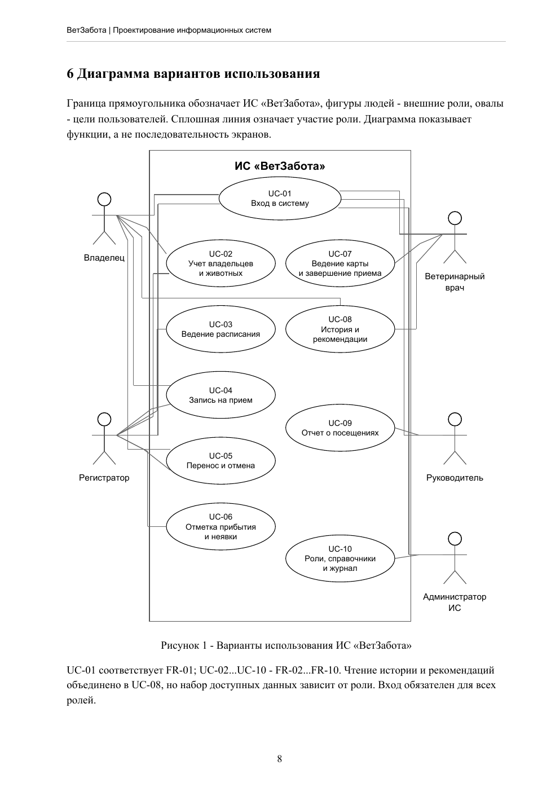
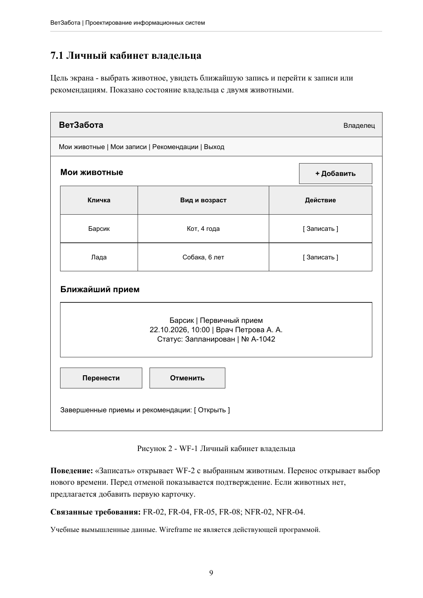
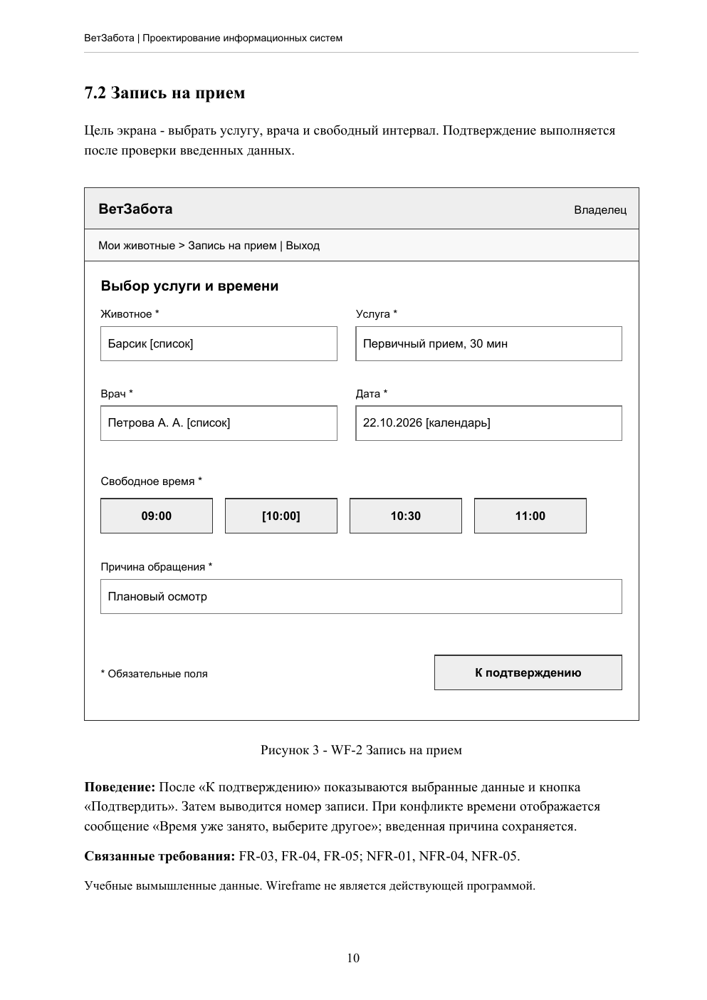
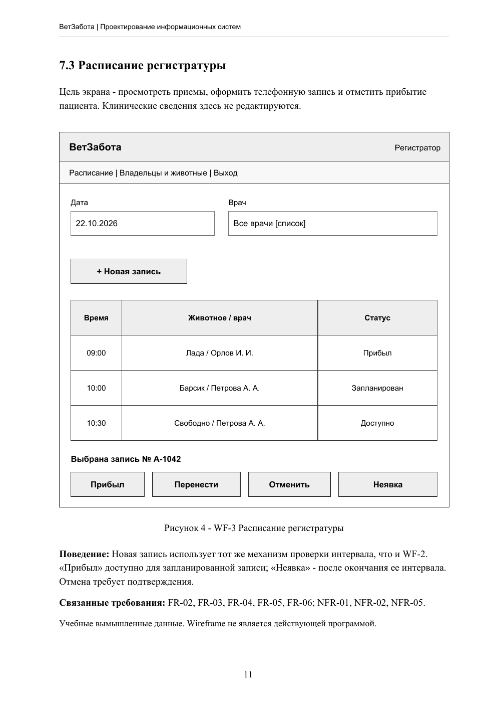
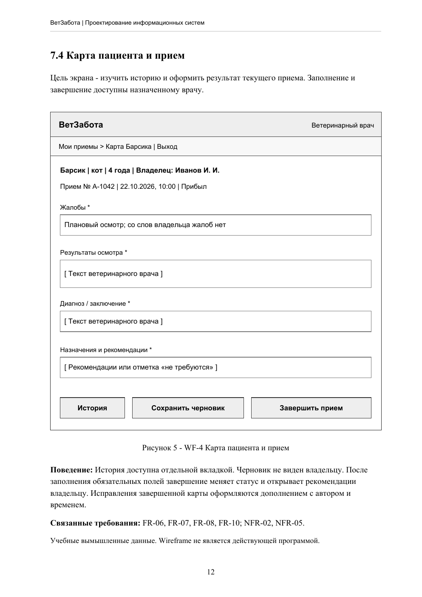
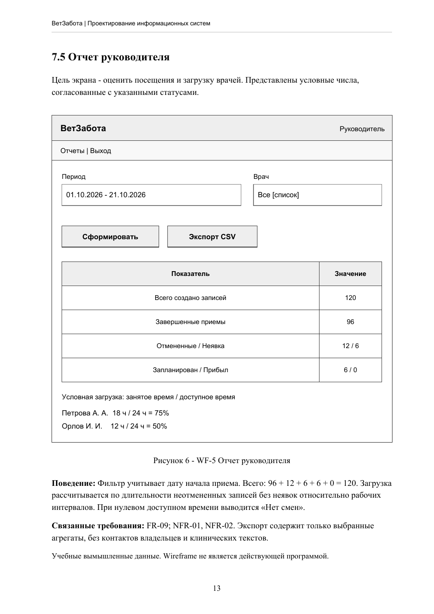

# Концепция информационной системы ветеринарной клиники «ВетЗабота»

Васильев Константин Юрьевич, 3 курс, группа 32501. 21.10.2026.

Учебная модель условной клиники. Это концепция, а не готовое приложение.

[Полный ответ в PDF](output/pdf/Васильев_КЮ_ВетЗабота_Проектирование_ИС.pdf)

[Условия задания](assignment.md)

## 1 Предметная область, проблема и цель

«ВетЗабота» - условная частная ветеринарная клиника, которая ведет прием домашних животных по предварительной записи. Для учебной модели приняты один филиал, три врача, два регистратора и руководитель. Это проектные допущения, а не сведения об обследованной организации.

В исходной модели запись ведется по телефону и в общей таблице, а сведения о животных хранятся в бумажных картах. Регистратор отдельно уточняет контакты, свободное время и историю посещений. При параллельной работе сотрудников возможны пересечения записей и повторное создание карточек.

Цель ИС - организовать единый учет владельцев, животных, записей и результатов приемов, чтобы сотрудники работали с актуальным расписанием, а владелец мог самостоятельно выбрать доступное время и получить сохраненные рекомендации врача.

Первая версия: кабинет владельца, расписание, учет пациентов, электронная карта приема и отчет о посещениях.

## 2 Классификация

Прикладное назначение: Фактографическая ИС (ФИС). Основа работы - хранение и обработка конкретных фактов: владелец, животное, дата приема, врач, жалобы, назначения. Сводный отчет дополняет учет, но не меняет его основное назначение.

Сфера применения: ИС организационного управления. Система автоматизирует работу регистратуры, врачей и руководителя: планирование приема, ведение карт и контроль посещений. Она не управляет медицинским оборудованием.

## Пользователи

Владелец животного: Видит только своих животных и свои записи; записывается, переносит и отменяет прием; читает завершенные рекомендации.

Регистратор: Создает карточки владельцев и животных, ведет расписание, записывает по телефону, отмечает прибытие. Не редактирует клинические записи врача.

Ветеринарный врач: Видит свой список приемов и карты назначенных ему пациентов; вносит результаты осмотра, диагноз и назначения, завершает прием.

Руководитель: Получает сводные показатели посещений и загрузки врачей за период. По умолчанию не получает тексты клинических записей.

Администратор ИС: Управляет учетными записями, ролями и справочниками услуг; запускает восстановление. Роль не дает штатного доступа к клиническому интерфейсу.

## 3 Основной процесс

1. Владелец: Выбирает животное и услугу, например первичный прием.

2. Система: Показывает подходящих врачей и свободные интервалы с учетом длительности услуги.

3. Владелец: Выбирает врача, дату и время, вводит краткую причину обращения, подтверждает запись.

4. Система: Проверяет обязательные поля, принадлежность животного владельцу и актуальную доступность интервала.

5. Система: В одной транзакции занимает интервал и создает запись со статусом «Запланирован».

6. Система: Показывает номер, время и врача; обновляет кабинет владельца и расписание регистратуры.

## 4 Функциональные требования

FR-01 Учетные записи и роли. Система должна обеспечивать вход владельца и сотрудников и назначение ролей администратором. Приемка: Пользователь без прав получает отказ при прямом запросе чужих данных.

FR-02 Владельцы и животные. Система должна хранить контакты владельца, кличку, вид, породу и дату рождения животного; связывать карточки. Приемка: Карточка животного открывается из записи и содержит ссылку на владельца.

FR-03 Расписание. Система должна хранить рабочие интервалы врачей и длительность услуг, показывать свободное время. Приемка: Вне смены и при пересечении с активной записью интервал недоступен.

FR-04 Создание записи. Владелец или регистратор должен иметь возможность записать животное на услугу к врачу. Приемка: После подтверждения одна запись с номером видна в кабинете и расписании.

FR-05 Перенос и отмена. Система должна позволять переносить и отменять будущие записи с проверкой доступности нового времени. Приемка: При неудачном переносе старая запись сохраняется; отмена освобождает интервал.

FR-06 Статусы приема. Система должна учитывать статусы «Запланирован», «Прибыл», «Завершен», «Отменен», «Неявка». Приемка: Регистратор отмечает прибытие и неявку; врач завершает состоявшийся прием.

FR-07 Электронная карта. Врач должен иметь возможность сохранять жалобы, результаты осмотра, диагноз и назначения. Приемка: Завершение требует заполнить обязательные поля; автор и время сохранены.

FR-08 История и рекомендации. Система должна показывать врачу историю пациента, владельцу - рекомендации завершенных приемов его животных. Приемка: Владелец видит итог своего приема, но не черновик и не чужую карту.

FR-09 Отчеты. Руководитель должен получать отчет о записях и посещениях с фильтрами периода и врача. Приемка: Итоги по статусам совпадают с выбранными записями; доступен экспорт CSV.

FR-10 Справочники и журнал. Администратор должен управлять услугами и ролями; система должна журналировать значимые изменения. Приемка: В журнале есть автор, время, объект и действие для записи, карты и изменения роли.

## 5 Нефункциональные требования

NFR-01 Быстродействие. При 20 одновременных пользователях и 10 000 записях не менее 95% запросов открытия расписания и карточки должны завершаться за 2 с; сохранение записи - за 3 с. Проверка: Нагрузочный сценарий длительностью 10 минут с фиксацией времени ответа, включая сетевой обмен в тестовой локальной сети.

NFR-02 Контроль доступа. Весь обмен с сервером должен идти по HTTPS. Сервер должен проверять роль и область доступа. Пароли не хранятся открытым текстом; бездействующая сессия закрывается через 30 минут. Проверка: Проверить матрицу ролей, прямые запросы к чужим объектам, настройки HTTPS, хранение хешей паролей и истечение сессии.

NFR-03 Восстановление. Резервная копия создается не реже одного раза в сутки; хранятся 7 суточных копий отдельно от основной БД. Допустимая потеря данных - до 24 ч, восстановление - до 4 ч. Проверка: Восстановить тестовую базу из последней копии, измерить длительность и сопоставить количество записей и связи.

NFR-04 Удобство интерфейса. Основные действия доступны с клавиатуры; поля имеют подписи, ошибки показаны рядом с полем. После входа запись из кабинета выполняется за 3 последовательных шага. Проверка: Пройти сценарий кабинет > выбор услуги и времени > подтверждение; проверить клавиатурную навигацию и ошибки обязательных полей.

NFR-05 Целостность данных. Не допускаются пересекающиеся активные записи одного врача и запись животного без владельца. Повторная отправка подтверждения не создает дубль. Проверка: Одновременно отправить два запроса на пересекающиеся интервалы: успешен только один. Повторить один запрос и проверить единственность записи.

## 6 Варианты использования

UC-01 Вход в систему: Владелец, Регистратор, Ветеринарный врач, Руководитель, Администратор ИС

UC-02 Учет владельцев и животных: Владелец, Регистратор

UC-03 Ведение расписания: Регистратор

UC-04 Запись на прием: Владелец, Регистратор

UC-05 Перенос и отмена: Владелец, Регистратор

UC-06 Отметка прибытия и неявки: Регистратор

UC-07 Ведение карты и завершение приема: Ветеринарный врач

UC-08 История и рекомендации: Владелец, Ветеринарный врач

UC-09 Отчет о посещениях: Руководитель

UC-10 Роли, справочники и журнал: Администратор ИС

## 7 Пять эскизов экранов

### WF-1 Личный кабинет владельца

### WF-2 Запись на прием

### WF-3 Расписание регистратуры

### WF-4 Карта пациента и прием

### WF-5 Отчет руководителя

## Источники

Учебная презентация Калугина А. И., задание DOCX и два образца титульных листов, предоставленные пользователем. Полные библиографические сведения и проверка полноты приведены на странице 15 PDF.
